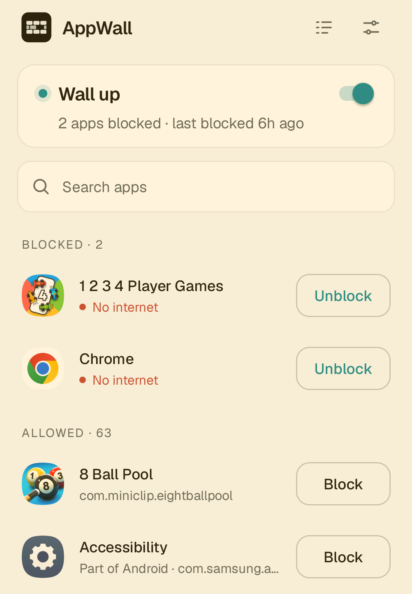
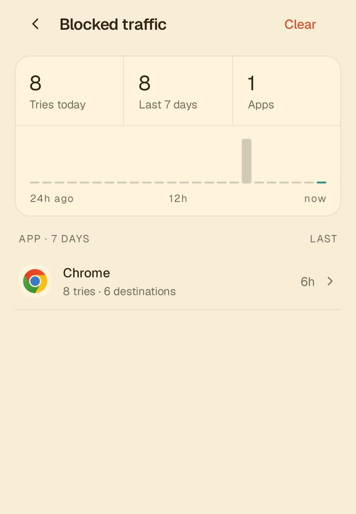
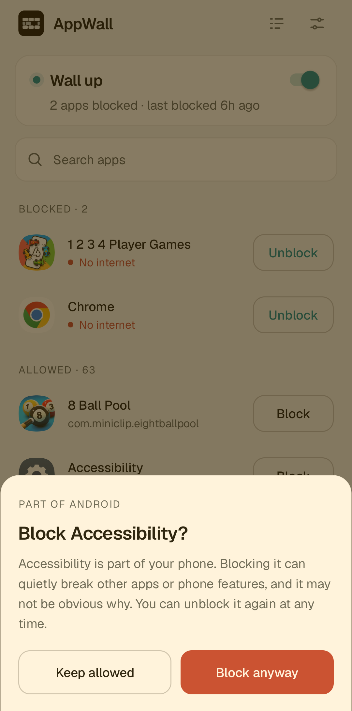

# AppWall

A simple, open-source firewall for Android that cuts off internet access for the apps you choose. No root needed, no server, no tracking.

<p>
  
  
  
</p>

## Why you can trust it

- **AppWall can't use the internet itself.** It doesn't request Android's internet permission, so it couldn't send anything anywhere even if it wanted to.
- **Your traffic never passes through it.** Apps you allow use your Wi-Fi or mobile data as usual. AppWall only sees the apps you block, and it drops everything they send.
- **No third-party code.** The app is built only on the Android framework: no ad or analytics SDKs, and no libraries at all.
- **Everything stays on your phone.** Your rules and the blocked traffic log are stored on the device and nowhere else.
- **Free software.** Licensed under the GPL v3, so anyone can read, build and check the code.

## What it does

- **Block any app with one tap**, or select several and block them at once. Undo is right there if you change your mind.
- **See what blocked apps tried to reach.** The blocked traffic log shows which domains or addresses each app tried, when, and how often.
- **Decide about new apps as they arrive.** When you install an app that can use the internet, AppWall asks whether to block it. You can also have new apps allowed or blocked automatically.
- **Warns before you break your phone.** Blocking a part of Android can quietly break other features, so AppWall asks first.
- **Keeps running.** It turns back on after a reboot or an update, and can guide you through setting up Android's Always-on VPN.
- **Shows its state clearly.** A notification shows when the firewall is on and how many apps it's blocking, and AppWall tells you if it had to stop.

## How it works

AppWall uses Android's VPN feature, but it is **not a VPN in the usual sense**.

When the firewall is on, AppWall creates a local tunnel on your phone and tells Android to send **only the blocked apps** into it. The tunnel leads nowhere: AppWall never forwards anything from it, so blocked apps get no network. Every other app is left untouched.

For the log, AppWall reads (but never forwards) what blocked apps send into the tunnel. Blocked apps are given a DNS server inside the tunnel that never answers, so their lookups land there too, and the log can show the domain names they tried to reach. You can turn logging off, and the log is kept for 7 days by default.

## Limitations

- **Only one VPN at a time.** Android allows a single active VPN app, so AppWall can't run alongside a regular VPN or another firewall such as NetGuard. AppWall tells you when that's the problem.
- **Don't turn on "Block connections without VPN"** for AppWall in Android's settings. It can cut off the internet for every app.
- **The VPN key icon may not appear** in the status bar on some phones (e.g. Samsung). Use AppWall's notification to see whether the firewall is on.
- **Android only.** iOS doesn't let an app block other apps' network access.

## Install

Requires Android 8.0 or newer.

Ready-to-install APKs will be published on the [Releases](https://github.com/gizawNahom/appwall/releases) page soon. Until then, build it from source.

### Build from source

You need JDK 17 and the Android SDK (platform 35, build-tools 35.0.0). Android Studio isn't required.

```bash
export JAVA_HOME=/path/to/jdk-17
export ANDROID_HOME=/path/to/android-sdk

./gradlew assembleDebug
```

The APK is written to `app/build/outputs/apk/debug/app-debug.apk`. To install it on a phone with USB debugging enabled:

```bash
adb install -r app/build/outputs/apk/debug/app-debug.apk
```

## Contributing

AppWall is written in Kotlin and split into two modules:

- **`:core`**: the decisions and calculations, as pure functions over immutable data, with no Android code. This is where the logic lives and where it's tested.
- **`:app`**: a thin Android shell that runs the VPN service, screens, storage and notifications, and passes what it sees to `:core`.

Run the tests with:

```bash
./gradlew test
```

Ground rules for changes:

- **A blocked app never gets network.** This comes before every other concern.
- **No dependencies.** Plain Android framework only. JUnit 4 and sqlite-jdbc are allowed in tests.
- **SQL must run on SQLite 3.18**, the version on Android 8.

## License

AppWall is free software, licensed under the [GNU General Public License v3.0 or later](LICENSE).

Copyright (C) 2026 gizawNahom

The bundled [Geist and Geist Mono](https://github.com/vercel/geist-font) typefaces are licensed under the SIL Open Font License 1.1 (see [third_party/Geist-OFL.txt](third_party/Geist-OFL.txt)).
